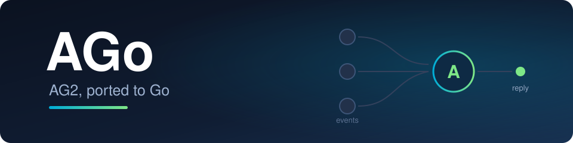

<a name="readme-top"></a>

<p align="center">
  
</p>

<p align="center">
  <a href="https://github.com/luckystrker/ago/actions/workflows/ci.yml">
    
  </a>
  <a href="https://github.com/luckystrker/ago/releases">
    
  </a>
  <a href="https://pkg.go.dev/github.com/luckystrker/ago">
    
  </a>
  <a href="https://github.com/luckystrker/ago/blob/main/go.mod">
    
  </a>
  <a href="LICENSE">
    
  </a>
  
</p>

<p align="center">
  <a href="docs/GUIDE.md">📚 Guide</a> |
  <a href="docs/MIGRATION.md">🔁 Migration from Python</a> |
  <a href="#-examples">💡 Examples</a> |
  <a href="docs/PORT_STATUS.md">🧭 Port status</a> |
  <a href="docs/DECISIONS.md">🧾 Decision records</a> |
  <a href="https://github.com/ag2ai/ag2">🐍 Original AG2</a>
</p>

> [!IMPORTANT]
> **Looking for `ConversableAgent`, `GroupChat`, or `initiate_chat`?** Those are the classic
> AutoGen APIs. AGo ports the **2026 event-sourced AG2** — one `Agent` type with
> `ask`/`run`, events on a stream, middleware, HITL hooks, and a multi-agent hub. The
> class-by-class mapping to Python lives in [docs/MIGRATION.md](docs/MIGRATION.md).

# AGo: the AG2 agent framework, compiled

AGo is an independent Go rewrite of [AG2](https://github.com/ag2ai/ag2) (port target:
AG2 `main` at commit `fa4e0fb`, 2026-10-27). One `Agent` type, an event stream per
conversation, tools registered as stream subscribers, middleware wrapped around every
turn, LLM call, tool execution and human-input hop — and a hub that hosts multi-agent
channels. **Zero external dependencies**: the framework is Go standard library only
(`net/http`, `encoding/json`, `os/exec`, `crypto/rand`); LLM providers talk raw
HTTP/SSE, no vendor SDKs.

Every package is gated by `go build` + `go vet` + `go test`, the event vocabulary is
wire-compatible with Python (JSON tags match field names, every event round-trips
through a `@type`-discriminated codec), and all 13 examples run offline on scripted
models — no API keys needed.

## ✨ What's in the box

| | |
|---|---|
| 🧠 **One `Agent` type** | blocking `Ask`, observable `Run`, continuations on the same stream, `Resume` from mid-trajectory |
| 📡 **Event-sourced core** | every observation is an event: pub/sub stream, durable transcript, replays and usage accounting are event logs |
| 🔧 **Tools as subscribers** | function tools with schema generation and dependency injection, toolkits, parallel execution, `final=true` tools, name precedence, hosted builtin tools executed by the provider (`web_search`, `code_execution`, …) |
| 🧰 **Tool packs** | ready-made tools over the framework: shell, local code runner, filesystem guard, DuckDuckGo/Tavily/Perplexity search, skills loader, dynamic sub-agent factory (`toolpacks`) |
| 🧩 **Plugins** | tools, middleware and prompt fragments bundled under one name (`plugin.Bundle`), applied to the agent at construction |
| 🌐 **7 LLM providers + Responses/Decisions** | OpenAI (Chat Completions **and** the Responses API with hosted tools, plus the Decisions API), Anthropic, Gemini, Ollama, Z.AI, Mistral, DashScope — full clients; xAI/Bedrock/TypeSafe as config stubs |
| 📁 **Files API** | provider-agnostic upload/read/list/delete — OpenAI and Anthropic clients behind one `files.API` wrapper |
| 🧅 **Middleware everywhere** | four hooks (turn / LLM call / tool execution / human input), conditional composition, limiters, retries, approvals; OTEL telemetry as the optional `contrib/otelx` module |
| 🙋 **Human-in-the-loop** | pluggable human hooks, tool approvals, timed-out asks, transcript repair for abandoned tool calls |
| 📦 **Structured output** | JSON-schema from Go types, validated answers with automatic re-asking |
| 🗂️ **Tasks & subtasks** | task lifecycle with checkpoints, `run_subtask`/`run_subtasks` fan-out with usage roll-up, `AsTool` delegation |
| 🧠 **Knowledge & policies** | virtual filesystem store with a self-describing bootstrap, change polling (`PollingWatcher`) and the model-facing `knowledge` tool (`agent.WithKnowledgeConfig`); optional SQLite/Redis modules; context-assembly policies (sliding window, token budget, alerts) |
| 🗜️ **Compaction & aggregation** | LLM-driven history summarization behind triggers, keeping the transcript valid for replay |
| 👀 **Observers & watches** | loop detection, token monitors, alert→halt flow, composable triggers |
| 🔌 **MCP, both sides** | client (stdio + streamable HTTP, paginated discovery, content mapping) and server (`mcpserver`: expose an agent as the conversational `ask` tool); MCP UI resources and in-frame actions for tool results |
| 🕸️ **Multi-agent network** | hub, channels, envelopes (`ag2.*` wire vocabulary), four channel adapters, workflow transitions, WAL replay, view projections, a pluggable arbiter, expectation sweepers with audit, task mirror, client LLM tools (`peers`/`channels`/`tasks`/`context`/`delegate`) |
| 🔗 **Protocol endpoints** | serve or consume agents over **A2A** (agent-card discovery, JSON-RPC + REST, tasks, push notifications, client-side tools and HITL over the wire, declarative security schemes), **ACP** (stdio JSON-RPC, both roles: cancel, load, full update vocabulary, mediated fs/terminal, MCP gateway, token auth), **AG-UI** (HTTP SSE, AG-UI 1.0, held-turn interrupts with resume) and **A2UI** (model-generated UI surfaces over HTTP, protocol v1.0) |
| 🧪 **Eval harness** | produce-then-grade runs: event-sourced traces (no OTEL), six scorer families + registry, JSONL datasets, failure attribution, LLM judge and dual-order pairwise, run diffs with regression gates, Wilson CI / Cohen's kappa, parallel cases |
| 🗣️ **Voice & terminal** | `live.Cascade` STT→LLM→TTS spoken turns (ready OpenAI stages); `tui.REPL` line chat with streaming echo |

## 📦 Install

One module — `github.com/luckystrker/ago` — serves both the framework and the `ago` CLI.

**The `ago` command-line helper** (version banner, environment doctor, offline demo):

```bash
go install github.com/luckystrker/ago/cmd/ago@latest
```

**The framework, as a dependency of your program:**

```bash
go get github.com/luckystrker/ago
```

```go
import (
	"github.com/luckystrker/ago/agent"
	"github.com/luckystrker/ago/tools"
)
```

**Or a prebuilt binary via the installer script** (fetches a release archive, verifies its
sha256, falls back to a source build):

```bash
curl -fsSL https://raw.githubusercontent.com/luckystrker/ago/main/install.sh | sh
```

## 🚀 Quick start

```go
package main

import (
	"context"
	"fmt"

	"github.com/luckystrker/ago/agent"
	"github.com/luckystrker/ago/events"
	agotest "github.com/luckystrker/ago/testing"
	"github.com/luckystrker/ago/tools"
)

func main() {
	// A tool: the argument struct's fields become the JSON-schema parameters.
	weather, err := tools.NewFunctionTool("get_weather",
		"Current weather for a city.",
		func(args struct {
			City string `json:"city" agschema:"description=City name"`
		}) (string, error) {
			return "sunny, +24 C", nil
		})
	if err != nil {
		panic(err)
	}

	// Scripted "model" so the example runs offline without API keys.
	cfg := agotest.NewTestConfig(
		&events.ModelResponse{
			ToolCalls: events.ToolCallsEvent{Calls: []events.ToolCallEvent{
				{ID: "call-1", Name: "get_weather", Arguments: `{"city":"Lisbon"}`},
			}},
		},
		&events.ModelResponse{
			Message: &events.ModelMessage{Content: "It is sunny, +24 C in Lisbon."},
		},
	)

	a := agent.New("assistant", "Answer using your tools.",
		agent.WithConfig(cfg),
		agent.WithTools(weather),
	)

	reply, err := a.Ask(context.Background(), "What is the weather in Lisbon?")
	if err != nil {
		panic(err)
	}
	fmt.Println(reply.Body())
}
```

> One Go module at the repo root: the framework packages (`agent/`, `events/`, `tools/`, … —
> import paths `github.com/luckystrker/ago/agent`, `github.com/luckystrker/ago/tools`, …) and
> the runnable examples in [`examples/`](examples/) inside the same module. Verify everything
> from the repo root: `go test ./...`.

## 📚 Documentation

| Document | Contents |
|---|---|
| [docs/GUIDE.md](docs/GUIDE.md) | the full user guide: concepts, every subsystem, working snippets |
| [docs/MIGRATION.md](docs/MIGRATION.md) | class-by-class map: Python AG2 → AGo |
| [docs/ARCHITECTURE.md](docs/ARCHITECTURE.md) | the binding package contracts |
| [docs/PORT_STATUS.md](docs/PORT_STATUS.md) | what is ported / partial / stubbed / deferred |
| [docs/DECISIONS.md](docs/DECISIONS.md) | 70+ decision records behind every deviation from Python |

## 🔐 Security

Read this before wiring AGo to a network. The framework's safety posture is "the
deployment is the security boundary" — three consequences matter:

**Network handlers ship with no authentication on by default.** Every HTTP/WebSocket
surface — `a2a`, `mcpserver`, `agui`, `a2ui`, the `contrib/wslink` link — is a plain
`http.Handler` that does not verify the caller unless you turn something on: no token
check, no Origin/Host fence, no rate limit. This is deliberate (Go services wrap
handlers with their own middleware), but it means a default-configured endpoint accepts
anyone who can reach it — on `a2a`, `message/send` drives the agent's LLM spend and
tools, and `tasks/get` returns conversation history. Therefore:

- keep the listener on **loopback** (`127.0.0.1`), or
- expose it only **behind an authenticating reverse proxy** and **enable the built-in
  auth hooks** — `a2a.ServerConfig.Authorize`, `mcpserver.ServerConfig.Authorize`,
  `a2ui.WithAuthToken` — or wrap the handler in your own auth middleware
  (`agui` and `contrib/wslink` rely on the wrapper).

Never bind a default-configured handler to a non-loopback interface.

**Shell and the code runner are not sandboxes.** `toolpacks.NewShellTool` and
`toolpacks.NewLocalCodeRunner` execute LLM-controlled commands and code on the host with
the full permissions of the process. There is no filesystem, network or memory
isolation — only a timeout, an output cap, an optional env allowlist and (for code) a
language allowlist; the Docker/Daytona sandbox backends of Python AG2 are not ported.
The shell block-pattern option is advisory filtering, not a security boundary. Treat
both tools as *executes arbitrary code by design*: wire the approval middleware
(`middleware.Approval`) or a HITL hook on every agent that carries them, and assume that
one prompt injection in any untrusted input the agent reads (search results, fetched
files, skill resources) is enough to reach that code execution.

**Outbound HTTP honors `HTTP_PROXY`/`HTTPS_PROXY` from the environment.** Provider
clients, MCP and the A2A client ride `net/http`, so ambient proxy variables apply to
every outbound request — standard Go behavior, not an AGo feature or bug. If a
production profile must not route LLM traffic through the ambient proxy, override it on
a custom transport (`http.Transport.Proxy = nil`).

## 💡 Examples

All examples run offline on scripted models — clone and `go run ./examples/<name>`:

| Example | Demonstrates |
|---|---|
| [`ask`](examples/ask) | basic ask, transcript, usage report |
| [`tools`](examples/tools) | function tools, tool-call round trip |
| [`hitl`](examples/hitl) | tool approval through a human hook |
| [`subagent`](examples/subagent) | agent delegation via `AsTool` |
| [`group`](examples/group) | multi-agent orchestration over the network hub |
| [`structured_output`](examples/structured_output) | schema-validated answers with re-asking |
| [`multi_turn`](examples/multi_turn) | multi-turn conversations on one stream |
| [`observers`](examples/observers) | loop detection, token monitoring, alerts |
| [`knowledge_memory`](examples/knowledge_memory) | persistent memory via the knowledge store |
| [`policies_compact`](examples/policies_compact) | context-assembly policies and compaction |
| [`safety_halt`](examples/safety_halt) | alert→halt safety flow |
| [`mcp_stdio`](examples/mcp_stdio) | MCP over a stdio subprocess |
| [`mcp_http`](examples/mcp_http) | MCP over streamable HTTP |

## 🧭 Status

- **Ported and gated:** the core framework, all 7 full providers **plus the OpenAI
  Responses and Decisions APIs**, tools (incl. hosted builtin tools and plugins), the
  tool packs, Files API, MCP client **and server** + MCP UI constructors, middleware,
  HITL, tasks, knowledge, policies, compaction, observers, watches, spec,
  multi-agent network (incl. views, arbiter, expectation sweepers, task mirror, client
  LLM tools), eval (attribution, registry, JSONL, diffs, stats, concurrency), TUI, live
  cascade — `go build`/`vet`/`test` green on every package (47 packages, 0 failures).
- **Protocol endpoints ported as functional subsets** (each remainder is a recorded
  decision): `github.com/luckystrker/ago/a2a` (push notifications, client-tools
  extension, context/HITL over the wire, REST, security schemes; gRPC closed
  permanently — D-071), `github.com/luckystrker/ago/acp` (cancel/load, full update
  vocabulary, mediated fs/terminal, MCP gateway, token auth), `github.com/luckystrker/ago/agui`
  (held-turn interrupts with resume proofs and state snapshots), `github.com/luckystrker/ago/a2ui`
  (model-generated UI over HTTP, v1.0 — parser, schema validation, actions, server,
  golden-tested against the running Python), `github.com/luckystrker/ago/eval`
  (event-sourced traces instead of OTEL).
- **Optional modules** under `contrib/` (own go.mod, external deps allowed only there;
  the core stays at zero): `knowledgesqlite`, `knowledgeredis`, `streamredis`, `wslink`
  (WebSocket network link), `otelx` (OpenTelemetry middleware). CI runs them as a
  dedicated job.
- **Stubbed:** xAI, Bedrock, TypeSafe configs (client construction returns an explicit
  "not implemented").
- **Deferred remainders** (honest, each with a decision record): A2UI v0.9/v0.9.1 and its
  Starlette/stream middleware (the v1.0 core is ported); the realtime
  audio stack and sound devices behind `live`; Docker/Daytona sandboxes behind the code
  runner; ACP OAuth auth kinds and the cross-process session store — see
  [docs/PORT_STATUS.md](docs/PORT_STATUS.md).
- **Reviewed:** an independent port-parity review against the Python sources found and
  fixed 20 confirmed defects; the review trail is in the git history and decision records.

## License

Apache-2.0 — the same license as AG2. See [LICENSE](LICENSE) and [NOTICE.md](NOTICE.md)
for provenance. AGo is an independent rewrite and is not affiliated with or endorsed by
the AG2ai maintainers.
